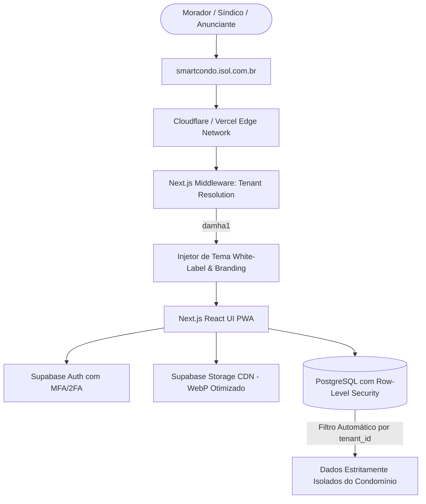

# 🏗️ 01 - Arquitetura & Stack Tecnológica

## 1. Visão Geral da Arquitetura

O **SmartCondo** foi projetado como um SaaS Multi-Tenant nativo, escalável e de altíssima performance visual, com entrega mobile-first via Progressive Web App (PWA) e preparação arquitetural para empacotamento em aplicativos nativos (iOS e Android).

---

## 2. Stack Tecnológica Definida

### **Frontend & Core**
- **Next.js (App Router):** Framework React fullstack para Server-Side Rendering (SSR), Static Generation (SSG/ISR) e roteamento dinâmico multi-tenant.
- **TypeScript:** Tipagem estrita de todos os modelos de dados, componentes e contratos de API.
- **Tailwind CSS:** Utilitários de estilização com variáveis de cores dinâmicas para personalização White-Label instantânea de cada condomínio.
- **Lucide Icons & Framer Motion:** Iconografia intuitiva e micro-animações suaves para carrosséis, comparador "Antes e Depois" e modais.
- **PWA (@ducanh2912/next-pwa):** Suporte completo a instalação na tela inicial (homescreen), ícones de app, splash screen e funcionamento rápido com cache.

### **Backend, Banco de Dados & Infraestrutura Multi-Tenant**
- **Supabase (PostgreSQL + Auth + Storage + RLS):**
  - **Row-Level Security (RLS):** Garantia matemática e estrutural no banco de dados de que nenhum condomínio consiga visualizar ou alterar dados de outro.
  - **Autenticação com 2FA:** Suporte a Two-Factor Authentication (TOTP / Token) para acesso seguro do Síndico e Super Admin.
  - **Storage de Mídias:** Uploads de fotos de alta resolução do "Antes e Depois" com compressão automática em WebP e CDN global.
- **Domínio Oficial:** `smartcondo.isol.com.br`
- **Hospedagem & Edge:** Vercel / Cloudflare com certificado SSL automatizado e suporte a subdomínios e domínios personalizados.

---

## 3. Resolução Multi-Tenant

A identificação do condomínio ativo ocorre de forma transparente através de:
1. **Subdomínio:** `damha1.smartcondo.isol.com.br`
2. **Rota com Slug:** `smartcondo.isol.com.br/damha1`
3. **Domínio Personalizado (White-Label Total):** `informativo.damha1.com.br`

Cada condomínio possui seu registro no banco com:
- Nome e Razão Social da Associação
- Logotipo oficial vetorizado / imagem
- Paleta de cores exclusiva (Primária, Secundária, Destaque, Eventos, Obras, Assembleias)
- Mensagem institucional de boas-vindas
- Contatos de emergência e telefones úteis da portaria
