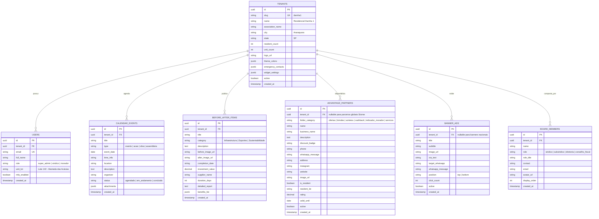

# 🗄️ 02 - Modelagem de Dados & Schema PostgreSQL

## 1. Diagrama Entidade-Relacionamento (ERD)



---

## 2. Isolamento de Segurança (Row-Level Security - RLS)

No PostgreSQL do Supabase, o isolamento multi-tenant é garantido no nível do banco através de políticas RLS:

```sql
-- Exemplo de política de segurança RLS para eventos
ALTER TABLE calendar_events ENABLE ROW LEVEL SECURITY;

CREATE POLICY "Moradores e visitantes podem visualizar eventos do seu condomínio"
ON calendar_events FOR SELECT
USING (
  tenant_id = (SELECT id FROM tenants WHERE slug = current_setting('app.current_tenant', true))
  OR auth.jwt()->>'tenant_id' = tenant_id::text
);

CREATE POLICY "Apenas síndicos do condomínio podem inserir ou editar eventos"
ON calendar_events FOR ALL
USING (
  auth.jwt()->>'tenant_id' = tenant_id::text 
  AND (auth.jwt()->>'role' = 'sindico' OR auth.jwt()->>'role' = 'super_admin')
);
```
