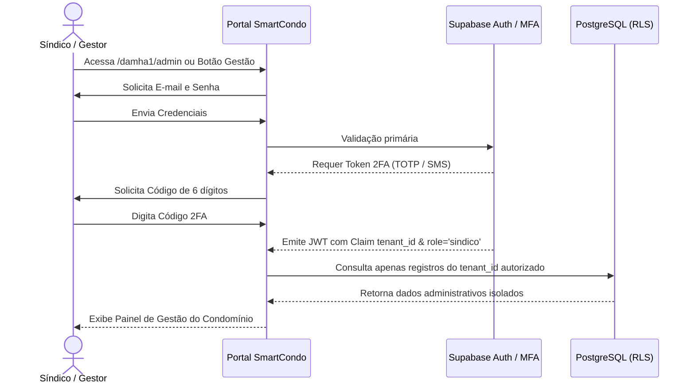

# 🔐 04 - Níveis de Acesso & Segurança

## 1. Matriz de Perfis de Acesso

A plataforma **SmartCondo** implementa 3 níveis hierárquicos de acesso com isolamento e permissões bem definidas:

| Perfil | Escopo | Nível de Autenticação | Principais Ações & Permissões |
| :--- | :--- | :--- | :--- |
| **Super Admin (Storne)** | Global (Todos os condomínios) | Login Master + 2FA TOTP | - Cadastrar e ativar novos condomínios/tenants. - Gerenciar anunciantes nacionais do Clube de Vantagens. - Configurar subdomínios e domínios personalizados. - Acessar métricas globais e faturamento de publicidade. |
| **Síndico / Admin** | Específico do Condomínio (Tenant) | Token Seguro + 2FA Obrigatório | - Cadastrar eventos, ações e assembleias no Calendário. - Publicar obras na Central de Arquivos com fotos de "Antes e Depois" e custos. - Aprovar moradores no Indicador Profissional. - Ativar/desativar widgets de tempo e cotações financeiras. |
| **Morador (Associado)** | Específico do Condomínio (Tenant) | Login / Token com Lote/Unidade | - Visualizar o calendário e programações do condomínio. - Consultar relatórios de obras e melhorias. - Acessar cupons, ofertas e sorteios do Clube de Vantagens. - Cadastrar gratuitamente seu serviço no Indicador Profissional do Morador. |

---

## 2. Fluxo de Segurança & 2FA para Síndico

