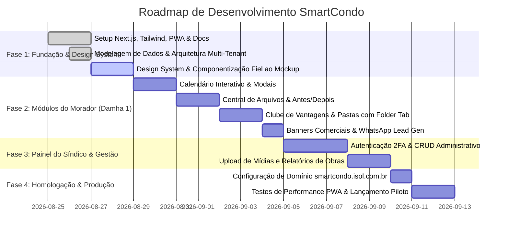

# 🚀 05 - Roadmap & Implantação

## 1. Cronograma de Desenvolvimento e Entregas

---

## 2. Checklist de Homologação para o Cliente Piloto (Damha 1)

- [x] Definição de domínio oficial: `smartcondo.isol.com.br`
- [x] Configuração da paleta oficial do Residencial Damha 1 Araraquara
- [x] Vetorização e renderização fiel do logotipo institucional
- [ ] Componentização completa dos 6 módulos e telas
- [ ] Implementação do comparador visual "Antes e Depois" com fotos em alta definição
- [ ] Navegação mensal dinâmica do calendário para Outubro de 2026 e datas correntes
- [ ] Grid de pastas do Clube de Vantagens com abas superiores (Folder Tab UI)
- [ ] Links diretos de acionamento de WhatsApp em todos os parceiros e botão de anúncio
- [ ] Testes de responsividade mobile-first e instalação PWA
